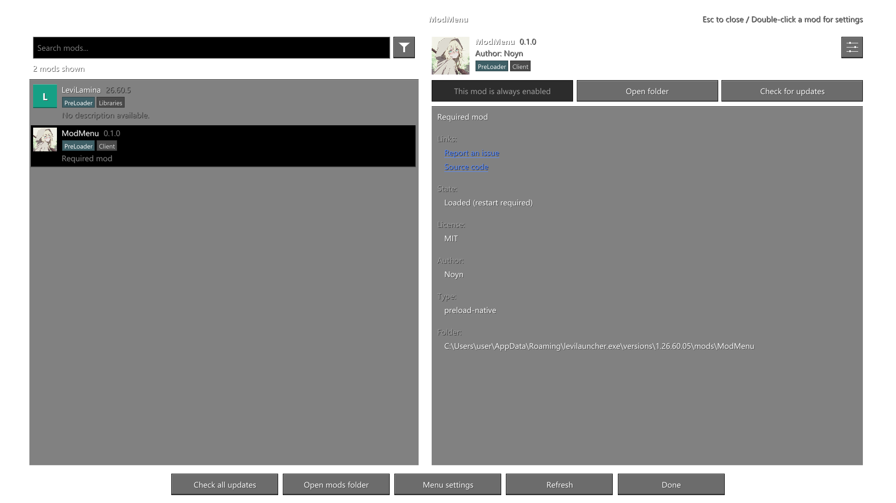

# ModMenu

[日本語](README.ja-JP.md) · [English](README.en-US.md) · [简体中文](README.md)

An in-game mod manager for **Minecraft Bedrock Edition (Windows GDK)**, for [LeviLauncher](https://github.com/LiteLDev/LeviLauncher) / LeviLamina players.

**Version 0.1.0** · **Author: Noyn** · **Windows x64** · **Minecraft 1.26.60.05**

## Preview

The English mod list shows only ModMenu and LeviLamina, rendered by `tests/Preview.cpp` as a transparent PNG.



## Features

- Open the mod list using **Mods** on the main menu or pause menu. Lists both `native` and `preload-native` mods.
- Search names, authors, badges, and optionally descriptions. Sort by name or prioritize updates; filter libraries, disabled mods, and unloaded mods.
- View icons, versions, authors, descriptions, links, licenses, load state, folders, and GitHub README files.
- Enable or disable mods by renaming `manifest.json` / `manifest.json.close`. Changes apply **after restarting the game** and can be reverted from the pending changes list.
- Edit existing JSON settings using a `modmenu.json` descriptor or the generic configuration editor. Open settings with the Config button, Enter, or a double-click.
- Check GitHub Releases individually or for all mods, and open download pages. Updates are not automatically downloaded or installed.
- Fill missing icons, descriptions, licenses, and links from the [LeviMC mod catalogue](https://levimc.org/mods/), and fetch repository README files.
- Review missing or disabled dependencies. Open a mod's `logs` folder when one exists.
- Use Up/Down to select a mod, **Enter** for settings, **Ctrl+F** to search, and **Esc** to go back.

There is no default global toggle key. An optional fallback key is available only when at least one Mods button has not been confirmed as inserted; it is **off by default**.

## Installation

Exit the game and place the release ZIP's `ModMenu` directory inside the target version's `mods/` directory:

```text
<game directory>/mods/ModMenu/
├── ModMenu.dll
├── manifest.json
├── assets/
│   └── icon.png
└── THIRD_PARTY_NOTICES.txt
```

ModMenu's icon is stored at `assets/icon.png`. It is included in the source and bundled with every build, including builds made by other users.

This version targets **Minecraft Bedrock 1.26.60.05 / Windows x64** and requires PreLoader symbol resolution and hooking functions. Open Mods from the main or pause menu after launching.

Menu settings are stored in `mods/ModMenu/config/menu.json`; logs are written to `mods/ModMenu/logs/latest.log`. Saving another mod's configuration first creates a `.bak` backup.

To migrate from BEModMenu, close the game and back up the old directory. Copy `BEModMenu/config` to `ModMenu/config`, then move the old installation out of `mods/` to avoid loading both versions.

## Display language

Use **Menu settings → Language** to cycle between **Follow game / 日本語 / English / 简体中文**. Changes apply immediately and are saved as `language` in `config/menu.json`: `auto`, `ja_JP`, `en_US`, or `zh_CN`.

Auto observes the game's language selection on the supported build. Until a selection is observed, or if the observer is unavailable, it uses the Windows UI language. If the initial game language is not detected, reselect it in the game's language settings. Unsupported languages fall back to English. Mod descriptions and README files are not automatically translated.

## Supporting ModMenu in your mod

The Config button edits JSON configuration files:

| What the mod provides | Config behavior |
| --- | --- |
| `config.files` in `modmenu.json` | Edit the specified JSON files |
| No descriptor | Search `config/` and root-level `config.json` / `settings.json` |
| `"config": false` | Hide the Config button |
| No editable JSON files | Hide Config; double-clicking shows an explanation |

This version does not provide a C API for custom settings screens, simulate another mod's hotkey, or load community adapters.

### 1. Manifest metadata

Add optional display metadata under `modmenu` in `manifest.json`:

```json
{
  "name": "ExampleMod",
  "entry": "ExampleMod.dll",
  "version": "1.0.0",
  "type": "native",
  "author": "ExampleAuthor",
  "description": "A description of this mod",
  "modmenu": {
    "displayName": "Example Mod",
    "icon": "icon.png",
    "license": "MIT",
    "links": {
      "source": "https://github.com/example/ExampleMod",
      "issues": "https://github.com/example/ExampleMod/issues"
    },
    "update": { "github": "example/ExampleMod" }
  }
}
```

| Field | Purpose |
| --- | --- |
| `displayName` / `description` | Override the displayed name or description |
| `icon` | Image path inside the mod directory |
| `license` / `links` | License and external links |
| `badges: ["library"]` | Treat the mod as a library |
| `parent` | Display the parent mod name and indent the list entry |
| `update.github` | GitHub update source in `owner/repository` form |

Without an explicit icon, ModMenu looks for `icon.png`, `assets/icon.png`, `pack_icon.png`, and `logo.png`. It then tries catalogue artwork, falling back to a letter icon. The update source is `update.github` or a GitHub repository in `links.source` / `links.sources`.

### 2. Configuration descriptor

Place `modmenu.json` in the mod directory. The target JSON file must already contain the keys and values you want to edit:

```json
{
  "config": {
    "files": [{
      "path": "config/options.json",
      "sections": [{
        "options": [{
          "key": "hud.enabled",
          "label": { "ja_JP": "HUDを表示", "en_US": "Show HUD", "zh_CN": "显示 HUD" }
        }, {
          "key": "hud.opacity",
          "label": "Opacity",
          "description": "HUD opacity",
          "min": 0,
          "max": 1
        }, {
          "key": "language",
          "label": "Language",
          "choices": [
            { "value": "ja_JP", "label": "日本語" },
            { "value": "en_US", "label": "English" },
            { "value": "zh_CN", "label": "简体中文" }
          ]
        }]
      }]
    }]
  }
}
```

- `path` is relative to the mod directory. Files outside that directory cannot be edited.
- `key` accepts dot-separated paths such as `hud.enabled`, or JSON Pointers such as `/hud/enabled`.
- Booleans use an on/off control. Numbers use an input field, or a slider when `min` / `max` are present. Strings use a text field.
- `choices` cycles through the listed values when clicked.
- `label` / `description` accept strings or language objects. The selected UI language is preferred, then English and other available values. `readOnly: true` prevents editing.
- `sections.options` supplies metadata for existing values. Custom ordering, section headings, `hidden`, `listedOnly`, `step`, and `format` are not supported.
- Mod metadata can also be placed in `modmenu.json`. Existing array elements can be edited, but elements cannot be added or removed.

## If Mods buttons are unavailable

Button insertion is skipped on unsupported game versions, modified menu definitions, or missing PreLoader functions. Menu settings show integration status and known failure reasons.

The fallback key cycles between **Off / F6–F10**. If you cannot enter the menu, close the game and add `"fallbackKey": 120` to `config/menu.json` to select F9. Preserve other fields and valid JSON. `0` disables the key; `117`–`121` select F6–F10.

The key is active only while at least one menu button is unconfirmed. It does not guarantee internal game integration on other versions.

## Building

Install Visual Studio 2022 C++ Build Tools, a Windows SDK, and [xmake](https://xmake.io). Development uses xmake 3.1.2. Run from the source root:

```powershell
xmake f -a x64 -m release -p windows -y
xmake -y
xmake build ModelTests
.\build\windows\x64\release\ModelTests.exe
powershell -File tools/package.ps1 -SkipBuild
```

Runtime files appear in `dist/ModMenu`; release ZIPs and SHA-256 checksums are written to `artifacts/`. GitHub Actions also builds, tests, and packages Windows binaries.

## Limits

- Native button integration targets executable **1.26.60.5** and verified menu definitions only.
- The UI uses a DirectX overlay. Opening it from the pause menu preserves that pause; opening it during gameplay with a fallback key does not pause the game itself.
- Dependency checks verify names and enabled states, not version constraints.
- Pending changes track enable/disable actions made during the current process. Undo does not overwrite externally modified manifests.
- Catalogue, image, and README retrieval connects to LeviMC and GitHub and stores results in `cache/`.
- Not every combination of mods, resource packs, multiplayer, and hardware has been tested.

## License

Source code: [MIT](LICENSE), Copyright © 2026 Noyn. Bundled library license texts are included in [THIRD_PARTY_NOTICES.txt](THIRD_PARTY_NOTICES.txt). The bundled icon and preview images are excluded from the source-code license and retain their original rights. System/game fonts and cached third-party artwork or README files are not redistributed.
