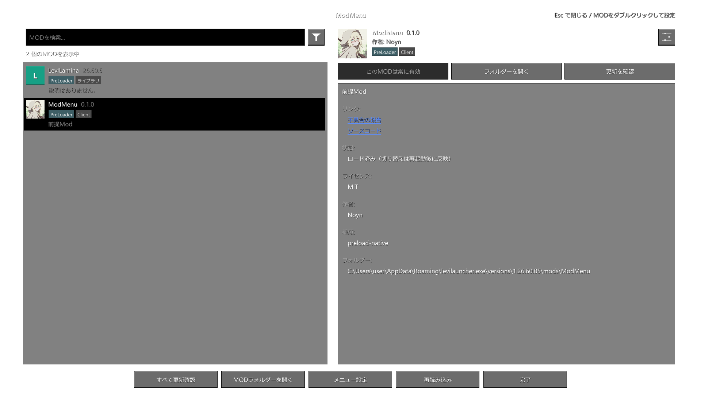

# ModMenu

[日本語](README.ja-JP.md) · [English](README.en-US.md) · [简体中文](README.md)

Minecraft Bedrock Edition（Windows GDK）向けのMOD管理メニュー。[LeviLauncher](https://github.com/LiteLDev/LeviLauncher) / LeviLamina環境で、ゲーム内からMODの情報やJSON設定を確認できます。

**Version 0.1.0** · **Author: Noyn** · **Windows x64** · **Minecraft 1.26.60.05**


## プレビュー

日本語表示のMOD一覧です。ModMenuとLeviLaminaのみを表示し、`tests/Preview.cpp`で透過PNGとして描画しています。



## 機能

- メイン画面・一時停止画面の **Mods** ボタンから開くMOD一覧。`native` と `preload-native` の両方を表示します。
- 検索、名前順・更新あり優先の並び替え、ライブラリ・無効・未ロードの絞り込み、状態ラベル。
- アイコン、バージョン、作者、説明、リンク、ライセンス、ロード状態、フォルダー、GitHubのREADMEを表示。
- MODの有効・無効を切り替え。`manifest.json` / `manifest.json.close` の名前を変更し、**ゲームの再起動後に反映**します。再起動待ち一覧から取り消せます。
- `modmenu.json` の説明に沿ったJSON設定編集と、設定ファイルの汎用エディター。設定ボタンまたは一覧のダブルクリックで開きます。
- GitHub Releasesの個別・一括更新確認。更新ファイルの自動導入は行いません。
- [LeviMCのMODカタログ](https://levimc.org/mods/)から、不足しているアイコン・説明・ライセンス・リンクを補完。対象リポジトリのREADMEも取得します。
- 前提MODの未導入・無効状態を表示。`logs` フォルダーがあるMODは、詳細から開けます。
- 上下キーで選択、**Enter** で設定、**Ctrl+F** で検索、**Esc** で戻る。

通常の開閉キーはありません。Modsボタンの追加を確認できない場合だけ使える代替キーを用意しており、**初期状態はオフ**です。

## 表示言語

「メニュー設定」の「言語」から **ゲームに合わせる / 日本語 / English / 简体中文** を選べます。変更はその場で反映し、`config/menu.json` の `language` に `auto` / `ja_JP` / `en_US` / `zh_CN` として保存します。初期状態は `auto`。対応版ではゲームの言語選択を監視し、取得できるまではWindowsの表示言語を使用します。起動直後にゲーム言語を取得できない場合は、ゲーム設定で言語を選択し直すと追従します。未対応言語はEnglishで表示します。MOD作者が提供する説明・READMEは自動翻訳しません。

## 導入

ゲームを終了し、Release ZIPの `ModMenu` フォルダーを、対象バージョンの `mods/` に置きます。

```text
<ゲームフォルダー>/mods/ModMenu/
├── ModMenu.dll
├── manifest.json
├── assets/
│   └── icon.png
└── THIRD_PARTY_NOTICES.txt
```

ModMenu自身のアイコンは`assets/icon.png`です。ソースに含まれており、他の人がビルドしても同じ画像を同梱します。

対象は **Minecraft Bedrock 1.26.60.05 / Windows x64** です。PreLoaderのシンボル解決・フック機能が必要です。起動後、メイン画面または一時停止画面のModsボタンから開いてください。

メニュー自身の設定は画面下の「メニュー設定」で変更できます。保存先は `mods/ModMenu/config/menu.json`、ログは `mods/ModMenu/logs/latest.log`。編集したMODの設定を保存すると、元ファイルの `.bak` を作成します。

旧BEModMenuから移行する場合は、ゲーム終了中に旧フォルダーをバックアップし、旧 `BEModMenu/config` を新しい `ModMenu/config` へコピーしてください。旧フォルダーは `mods` の外へ移し、旧版と新版を同時にロードしないようにします。

## 自分のMODをModMenuへ対応させる

「設定」ボタンは、MODのJSON設定ファイルを編集する画面を開きます。対応状況による動作は次のとおりです。

| MOD側の用意 | 設定ボタンの動作 |
| --- | --- |
| `modmenu.json` の `config.files` | 指定したJSONファイルを編集 |
| 説明ファイルなし | `config/` 配下と、MOD直下の `config.json` / `settings.json` を探索 |
| `"config": false` | 設定ボタンを表示しない |
| 編集可能なJSONファイルがない | 設定ボタンを表示しない。ダブルクリックでは案内を表示 |

MOD固有の設定画面を呼び出すAPI、独自画面のホットキー代行、コミュニティーアダプターの読み込みには対応していません。

### 1. manifestでMOD情報を補う

`manifest.json` の `modmenu` に表示情報を記述できます。以下のフィールドは任意です。

```json
{
  "name": "ExampleMod",
  "entry": "ExampleMod.dll",
  "version": "1.0.0",
  "type": "native",
  "author": "ExampleAuthor",
  "description": "このMODの説明",
  "modmenu": {
    "displayName": "Example Mod",
    "icon": "icon.png",
    "license": "MIT",
    "links": {
      "source": "https://github.com/example/ExampleMod",
      "issues": "https://github.com/example/ExampleMod/issues"
    },
    "update": { "github": "example/ExampleMod" }
  }
}
```

| フィールド | 用途 |
| --- | --- |
| `displayName` / `description` | 表示名・説明の上書き |
| `icon` | MODフォルダー内の画像パス |
| `license` / `links` | ライセンスと外部リンク |
| `badges: ["library"]` | ライブラリとして扱う |
| `parent` | 親MOD名を表示し、一覧で字下げする |
| `update.github` | GitHubの `owner/repository` を更新確認先として指定 |

アイコン未指定時は `icon.png`、`assets/icon.png`、`pack_icon.png`、`logo.png` を探します。ローカル画像がない場合はカタログの画像、取得できない場合は文字の代替アイコンを使います。更新元は `update.github`、または `links.source` / `links.sources` のGitHubリポジトリから決定します。

### 2. modmenu.jsonで設定項目を説明する

MODフォルダーへ `modmenu.json` を置き、編集対象と項目の表示方法を記述します。対象ファイルには、編集したいキーと値をあらかじめ用意してください。

```json
{
  "config": {
    "files": [
      {
        "path": "config/options.json",
        "sections": [
          {
            "options": [
              {
                "key": "hud.enabled",
                "label": { "ja_JP": "HUDを表示", "en_US": "Show HUD", "zh_CN": "显示 HUD" }
              },
              {
                "key": "hud.opacity",
                "label": "不透明度",
                "description": "HUDの表示濃度",
                "min": 0,
                "max": 1
              },
              {
                "key": "language",
                "label": "言語",
                "choices": [
                  { "value": "ja_JP", "label": "日本語" },
                  { "value": "en_US", "label": "English" }
                ]
              }
            ]
          }
        ]
      }
    ]
  }
}
```

- `path` はMODフォルダーからの相対パス。MODフォルダー外のファイルは対象にしません。
- `key` は `hud.enabled` のようなドット区切り、または `/hud/enabled` のJSON Pointer形式で指定します。
- 真偽値はオン・オフ、数値は入力欄、`min` / `max` のある数値はスライダー、文字列は入力欄です。
- `choices` のある項目は、ボタンを押すたびに候補を切り替えます。
- `label` / `description` は文字列または言語オブジェクト。選択中の表示言語を優先し、なければ英語などの値を使います。`readOnly: true` で変更を禁止できます。
- `sections.options` は既存項目の表示情報として使います。独自の並び順・セクション見出し、`hidden`、`listedOnly`、`step`、`format` の指定は未対応です。
- `modmenu.json` にMOD情報のフィールドも置けます。汎用エディターでは配列の既存要素を編集できますが、要素の追加・削除はできません。

## Modsボタンが追加されない場合

対応版以外、変更済みメニュー定義、必要なPreLoader機能がない場合は、ボタンの追加を見送ります。メニュー設定に追加状況と、判明した失敗理由を表示します。

代替キーはメニュー設定で **オフ / F6〜F10** から選べます。メニューへ一度も入れない場合は、ゲーム終了中に `config/menu.json` へ `"fallbackKey": 120` を追加するとF9を選択できます。既存項目を残し、有効なJSONとして保存してください。`0` はオフ、`117`〜`121` がF6〜F10です。

代替キーはメイン・一時停止のどちらかのボタンの追加を確認できない間だけ有効です。未対応ゲーム版でのゲーム内部連携まで保証するものではありません。

## ビルド

Visual Studio 2022 C++ Build Tools、Windows SDK、[xmake](https://xmake.io)を用意し、ソースのルートで実行します。開発時はxmake 3.1.2を使用しています。

```powershell
xmake f -a x64 -m release -p windows -y
xmake -y
```

出力は `dist/ModMenu/`。モデルテストと配布ZIP作成は次のとおりです。

```powershell
xmake build ModelTests
.\build\windows\x64\release\ModelTests.exe
powershell -File tools/package.ps1 -SkipBuild
```

ZIPとSHA-256チェックサムは `artifacts/` へ出力します。GitHub ActionsにもWindows向けビルド・モデルテスト・ZIP作成を用意しています。

## 対応範囲・制限

- ゲーム内のボタン接続は **実行ファイル1.26.60.5と確認済みのメニュー定義** に限定しています。
- 画面はDirectXオーバーレイです。一時停止から開いた場合は背面の一時停止を維持します。通常プレイ中に代替キーで開く場合、ゲーム自体を一時停止する機能はありません。
- 前提MODは名前と有効状態を確認し、バージョン制約は検証しません。
- 再起動待ち一覧は、このプロセスから行った有効・無効操作を追跡します。manifestに外部編集がある場合は上書きして取り消しません。
- カタログ・画像・README取得ではLeviMCやGitHub等へ接続し、取得物を `cache/` へ保存します。
- すべてのMOD・リソースパック・マルチプレイ環境の組み合わせを検証したものではありません。


## ライセンス

ソースコードは[MIT](LICENSE)、Copyright © 2026 Noyn。同梱ライブラリのライセンスは[THIRD_PARTY_NOTICES.txt](THIRD_PARTY_NOTICES.txt)にまとめています。同梱アイコンとプレビュー画像はソースコードのMITライセンスには含まれません。画像の権利はその権利者に帰属します。システムフォント・ゲームフォントや、外部から取得した他MODの画像・READMEは再配布しません。
