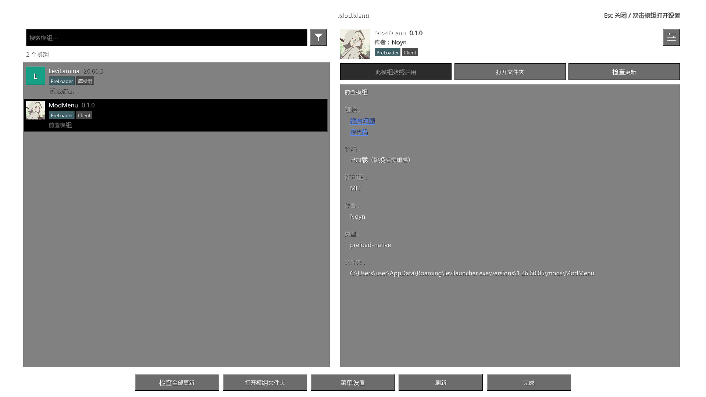

# ModMenu

[日本語](README.ja-JP.md) · [English](README.en-US.md) · [简体中文](README.md)

适用于 **Minecraft 基岩版 Windows GDK** 的游戏内模组管理菜单，供 [LeviLauncher](https://github.com/LiteLDev/LeviLauncher) / LeviLamina 玩家使用。

**版本 0.1.0** · **作者：Noyn** · **Windows x64** · **Minecraft 1.26.60.05**

## 预览

简体中文界面的模组列表，仅显示 ModMenu 和 LeviLamina。由 `tests/Preview.cpp` 绘制并导出透明 PNG。



## 功能

- 从主菜单或暂停菜单的 **Mods** 按钮打开，列出 `mods/` 下的 `native` 和 `preload-native` 模组。
- 按名称、作者、标签搜索；可选搜索描述。支持名称排序、有更新的优先，以及库模组、已禁用和未加载模组筛选。
- 显示图标、版本、作者、描述、链接、许可证、加载状态、文件夹和 GitHub README。
- 启用或禁用模组：在 `manifest.json` 和 `manifest.json.close` 之间重命名，**重启游戏后生效**。可在等待重启的更改列表中撤销。
- 根据 `modmenu.json` 编辑已有 JSON 配置，也提供通用配置编辑器。点击设置按钮或双击模组即可打开。
- 单独或批量检查 GitHub Releases 更新，并打开下载页面；不自动下载或安装。
- 从 [LeviMC 模组目录](https://levimc.org/mods/)补充缺失的图标、描述、许可证和链接，并获取对应仓库的 README。
- 显示前置模组缺失或已禁用的状态。存在 `logs` 文件夹时，可从详情打开。
- 上下方向键选择、**Enter** 打开设置、**Ctrl+F** 搜索、**Esc** 返回。

没有默认的全局开关快捷键。只有无法确认 Mods 按钮已添加时，才会启用可选备用按键，**默认关闭**。

## 界面语言

打开底部的 **菜单设置 → 语言**，循环选择：

- **跟随游戏**（默认）
- **日本語**
- **English**
- **简体中文**

切换后立即生效，并保存在 `mods/ModMenu/config/menu.json` 的 `language` 字段中，取值分别为 `auto`、`ja_JP`、`en_US`、`zh_CN`。

在支持的游戏版本中，自动模式会监听游戏的语言选择。尚未获取到游戏语言或相关功能不可用时，使用 Windows 显示语言；如果启动时未获取到游戏语言，可在游戏设置中重新选择语言以触发同步。不支持的语言回退到英语。配置项目的多语言标签优先使用当前界面语言。模组作者提供的描述及 README 不会自动翻译。

## 安装

关闭游戏，将发布 ZIP 内的 `ModMenu` 文件夹放入对应版本的 `mods/`：

```text
<游戏目录>/mods/ModMenu/
├── ModMenu.dll
├── manifest.json
├── assets/
│   └── icon.png
└── THIRD_PARTY_NOTICES.txt
```

ModMenu 自身的图标位于 `assets/icon.png`，已包含在源码中；其他用户自行构建时也会打包同一张图片。

目标版本为 **Minecraft 基岩版 1.26.60.05 / Windows x64**，需要 PreLoader 的符号解析和挂钩功能。启动后，从主菜单或暂停菜单的 Mods 按钮打开。

菜单设置保存在 `mods/ModMenu/config/menu.json`，日志位于 `mods/ModMenu/logs/latest.log`。保存其他模组的配置时，会先创建原文件的 `.bak` 备份。

从旧 BEModMenu 迁移时，请关闭游戏并备份旧目录，将旧 `BEModMenu/config` 复制到新 `ModMenu/config`，再将旧模组目录移出 `mods/`，避免同时加载两个版本。

## 让你的模组支持 ModMenu

设置按钮打开的是 JSON 配置编辑器：

| 模组提供的内容 | 设置按钮的行为 |
| --- | --- |
| `modmenu.json` 的 `config.files` | 编辑指定的 JSON 文件 |
| 没有描述文件 | 搜索 `config/` 下的 JSON，以及模组根目录的 `config.json` / `settings.json` |
| `"config": false` | 隐藏设置按钮 |
| 没有可编辑的 JSON 文件 | 隐藏设置按钮，双击时显示提示 |

不提供调用模组自定义界面的 C API、模拟其他模组快捷键或加载社区适配器的功能。

### 1. 模组信息

可在 `manifest.json` 的 `modmenu` 对象中添加 `displayName`、`description`、`icon`、`license`、`links`、`parent` 和 `update.github`。`badges: ["library"]` 将模组标记为库模组。

未指定图标时依次查找 `icon.png`、`assets/icon.png`、`pack_icon.png`、`logo.png`。没有本地图标时尝试目录中的图片，仍不可用时显示字母图标。更新来源使用 `update.github` 中的 `owner/repository`，或 `links.source` / `links.sources` 指向的 GitHub 仓库。

### 2. 配置描述

将 `modmenu.json` 放在模组文件夹中。例如：

```json
{
  "config": {
    "files": [{
      "path": "config/options.json",
      "sections": [{
        "options": [{
          "key": "hud.enabled",
          "label": {
            "ja_JP": "HUDを表示",
            "en_US": "Show HUD",
            "zh_CN": "显示 HUD"
          }
        }, {
          "key": "hud.opacity",
          "label": {"en_US": "Opacity", "zh_CN": "不透明度"},
          "min": 0,
          "max": 1
        }]
      }]
    }]
  }
}
```

请事先在目标 JSON 文件中准备对应的键和值。

- `path` 是相对于模组目录的路径，不能访问模组目录之外的文件。
- `key` 可使用 `hud.enabled` 形式，或 `/hud/enabled` 形式的 JSON Pointer。
- 布尔值显示开关；数值使用输入框，带 `min` / `max` 时使用滑块；字符串使用输入框。
- `choices` 提供可循环选择的候选值。`readOnly: true` 禁止修改。
- `label` / `description` 可使用字符串或语言对象，优先选择当前显示语言，然后回退到英语等可用值。
- 尚不支持自定义项目顺序、分区标题、`hidden`、`listedOnly`、`step`、`format`。通用编辑器可修改数组已有元素，不能添加或删除元素。

完整的清单和候选值示例见 [英文说明](README.en-US.md)。

## Mods 按钮不可用时

遇到不支持的游戏版本、修改过的菜单定义或缺少 PreLoader 功能时，会跳过按钮注入。菜单设置中会显示集成状态及已知原因。

可选备用按键为 **关 / F6～F10**。如果完全无法进入菜单，可在关闭游戏后，在 `config/menu.json` 中加入 `"fallbackKey": 120` 选择 F9。保留已有字段并确保 JSON 有效。`0` 代表关闭，`117`～`121` 对应 F6～F10。

备用按键仅在至少一个菜单按钮未确认添加时有效，不代表对其他游戏版本的内部集成提供保证。

## 构建

准备 Visual Studio 2022 C++ Build Tools、Windows SDK 和 [xmake](https://xmake.io)。开发环境使用 xmake 3.1.2。

```powershell
xmake f -a x64 -m release -p windows -y
xmake -y
xmake build ModelTests
.\build\windows\x64\release\ModelTests.exe
.\tools\package.ps1 -SkipBuild
```

运行文件输出到 `dist/ModMenu`，发布 ZIP 输出到 `artifacts/`。

## 许可证

源代码采用 [MIT](LICENSE)，Copyright © 2026 Noyn。第三方库许可证原文汇总于 [THIRD_PARTY_NOTICES.txt](THIRD_PARTY_NOTICES.txt)。随附的图标和预览图片不属于源代码 MIT 许可范围，其权利归原权利人所有。系统及游戏字体、缓存的其他模组图片和 README 不随本项目分发。
